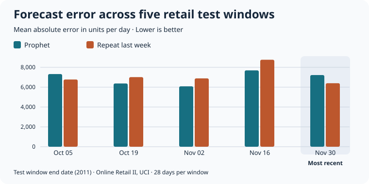

# Merchant Field Kit
Practical data science for decisions in online shops. Start with a forecast, see how it performed on past data, and decide whether it is useful for your store.

## First tool: forecast daily ordered units for the next four weeks

**Local Docker** (no GPU, account, or external model API):
```sh
docker build -t merchant-field-kit .
docker run --rm -p 127.0.0.1:8501:8501 merchant-field-kit
```

**Local Python 3.12**, from the project folder:
```sh
python -m venv .venv
# macOS/Linux:
source .venv/bin/activate
# Windows PowerShell: use .venv\Scripts\Activate.ps1 instead.
python -m pip install -r requirements.txt
python -m streamlit run forecast_app.py
```

Open **http://localhost:8501**, choose **Sample shop** or **My daily totals**, then **Run forecast**. To try the upload path, select `examples/sample_shop.csv`, a synthetic 224-day shop history. Download a 28-row forecast CSV. A network connection is needed to install dependencies or build the image, not to compute predictions.

Your file is processed by the Python process wherever it is running. In the default local setup it stays on your machine; the app doesn't persist uploads to a database or call an external model API. A hosted version would receive uploaded files on that host. Do not open this upload-enabled app to anonymous traffic without first addressing upload policy, access, compute limits, and retention. A public demo should use sample data only; the supplied app is configured for **local** use.

### Input

UTF-8 CSV, exactly `date,units_ordered`; one store-local date per row, YYYY-MM-DD; at least **112 consecutive days**, and whole nonnegative counts. Aggregate across a whole store or one consistent category. Fill a day with zero only when you know nothing sold; fix gaps in an export rather than hiding them. Upload daily totals only, no order or customer identifiers. Ordered units are gross ordered items, not net revenue, units on hand, or unmet demand.

### Model comparison

Prophet fits a trend with changepoints and weekly seasonality. Compare it with repeating the last seven days and the last 28 days' average. Each is evaluated on the same three to five rolling 28-day windows; every fit uses only data before its cutoff. The metric is mean absolute error in units per day, computed on unrounded predictions. Overlapping windows are not independent. Scores are used to choose a model, not proof of future accuracy. The winner is rerun on all data and rounded for export. No annual or holiday effects in this version; promotions, stockouts, and structural changes can limit usefulness.

## What happened on one real retail dataset?



On five overlapping 28-day windows, Prophet averaged **6,937** units/day of error versus **7,165** for repeating last week (3.17% lower). Repeat last week was better on the most recent window. This is one wholesale-heavy gift retailer in 2011, not an independent holdout or a claim about sales lift.

Source: Daqing Chen, *Online Retail II*, UCI Machine Learning Repository ([dataset](https://doi.org/10.24432/C5CG6D), [CC BY 4.0](https://creativecommons.org/licenses/by/4.0/)). See [data preparation and limits](docs/benchmark.md) and the [per-window scores](docs/benchmark_folds.csv).

## Checks

```sh
python -m pip install -r requirements-dev.txt
python -m pytest -q
```
